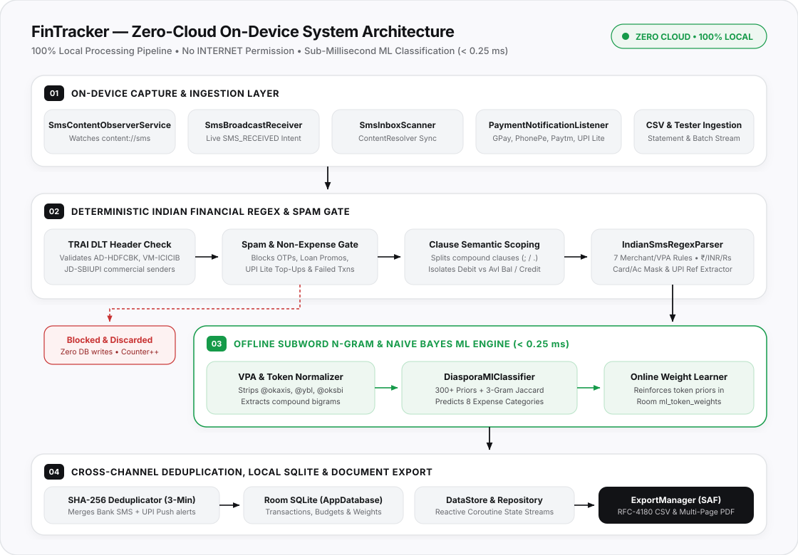
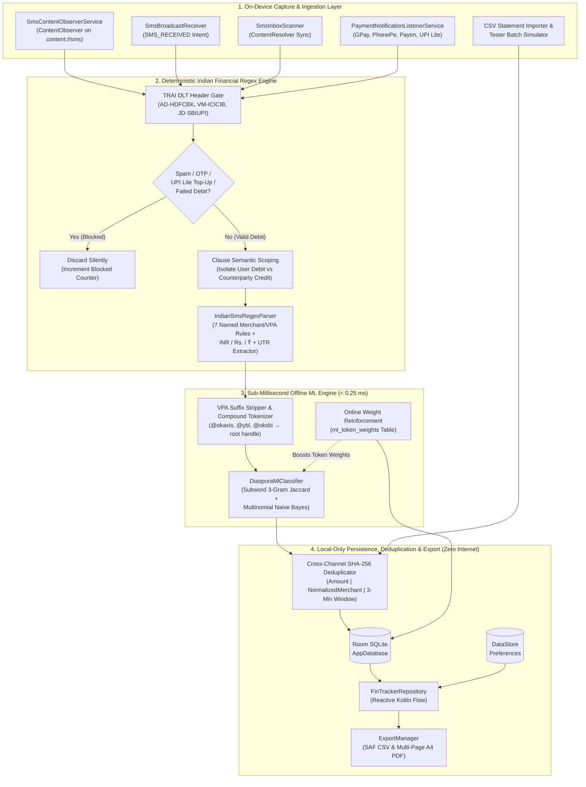

<div align="center">


# FinTracker

### Privacy-First, Zero-Cloud Android Expense Tracker for Indian & Diaspora Financial Workflows

[-121316?style=flat-square&logo=android&logoColor=159A49)](https://developer.android.com)
[](https://kotlinlang.org)
[](#overview)
[-121316?style=flat-square)](#on-device-ml-classification-engine)
[](../../releases)
[](LICENSE)

*Automatically captures, filters, and classifies Indian Bank SMS alerts, Credit/Debit Card swipes, and NPCI UPI / UPI Lite notifications strictly on-device with zero network permissions.*

[GitHub Releases (User & Tester APKs)](../../releases) •
[Project Report (PDF)](docs/FinTracker_Project_Report.pdf) •
[System Architecture](#system-architecture-flowchart) •
[SMS & UPI Parsing Pipeline](#multi-stage-sms--upi-parsing-pipeline) •
[On-Device ML Engine](#on-device-ml-classification-engine) •
[Testing Suite](#testing--validation-suite) •
[Getting Started](#download-apks-releases--getting-started)

</div>

---

## Overview

**FinTracker** is an open-source, privacy-first Android expense tracker purpose-built for **Indian financial workflows** (UPI, UPI Lite, IMPS/NEFT, Credit/Debit Cards, and Bank SMS alerts) as well as **Indian diaspora spending**.

Unlike conventional finance apps that upload personal SMS inboxes to remote servers or rely on cloud LLMs, FinTracker declares **zero internet permissions** in `AndroidManifest.xml`. Every transaction is captured, filtered, parsed, classified, deduplicated, and stored **100% locally on-device** in sub-millisecond latency.

---

## Key Features

- **Zero Cloud Dependency & Strict Data Privacy**:
  - No `android.permission.INTERNET` permission in the manifest—making network exfiltration technically impossible.
  - All transactions, budgets, and learned merchant weights remain in an on-device **Room SQLite** database.
- **On-Device Subword N-Gram & Multinomial Naive Bayes ML (`< 0.25 ms` Inference)**:
  - Pure-Kotlin offline classifier combining FastText-inspired character trigram Jaccard similarity with TF-IDF Multinomial Naive Bayes log-likelihood scoring.
  - Pre-seeded with **300+ Indian & diaspora merchant priors** across 8 categories, plus **online weight reinforcement** stored in SQLite whenever a merchant category is updated.
- **Smart Indian SMS & UPI Notification Parsing**:
  - Real-time background `ContentObserver` service (`SmsContentObserverService`) watching `content://sms` + live `SMS_RECEIVED` broadcast receiver + historical inbox scanner.
  - Companion `PaymentNotificationListenerService` for **small-value UPI & UPI Lite** transactions where banks skip sending SMS alerts.
  - **TRAI DLT Header Validation**, **Clause Semantic Scoping**, and deterministic filters that block OTP security codes, pre-approved loan spam, failed/reversed debits, and UPI Lite top-up double counting.
- **Dual Build Architecture (`User` vs. `Tester` APK)**:
  - **User Build (`FinTracker-user.apk`)**: Production build with all synthetic SMS simulators and parser lab tools stripped at compile time (`BuildConfig.ENABLE_TESTING_TOOLS = false`).
  - **Tester Build (`FinTracker-tester-debug.apk`)**: Evaluator and QA build with the built-in Indian Regex SMS Parser Lab and multi-message batch simulator (`BuildConfig.ENABLE_TESTING_TOOLS = true`).
- **Native CSV & Multi-Page A4 PDF Exports**:
  - Zero-permission export via Android's Storage Access Framework (`CreateDocument`).

---

## System Architecture Flowchart

FinTracker operates as a **strictly offline, reactive data pipeline** from OS message capture to local Room SQLite persistence and document export:

<p align="center">
  
</p>

<details>
<summary>Interactive Mermaid Flowchart (Click to expand)</summary>



</details>

---

## Multi-Stage SMS & UPI Parsing Pipeline

Indian bank SMS messages and UPI push notifications are notoriously noisy—combining multiple clauses (`"ICICI Acct XX123 debited for Rs 1,899; ZUDIO RETAIL credited"`), varying currency prefixes (`₹`, `Rs.`, `INR`, or bare `debited by 640.50`), and high volumes of OTP/loan spam.

FinTracker processes every incoming message or notification through a deterministic **6-stage local pipeline**:

```text
┌──────────────────────────────────────────────────────────────────────────────┐
│  Stage 1: Capture Sources                                                    │
│  • SmsContentObserverService (ContentObserver on content://sms)              │
│  • SmsBroadcastReceiver (Telephony.Sms.Intents.SMS_RECEIVED_ACTION)          │
│  • PaymentNotificationListenerService (GPay, PhonePe, Paytm, BHIM, CRED...)  │
└──────────────────────────────────────┬───────────────────────────────────────┘
                                       ▼
┌──────────────────────────────────────────────────────────────────────────────┐
│  Stage 2: TRAI DLT Header & Spam / OTP / UPI-Lite Exclusion Gate             │
│  • Validates TRAI commercial headers (e.g., AD-HDFCBK, VM-ICICIB, JD-SBIUPI) │
│  • Rejects OTPs, MPIN/CVV alerts, pre-approved loan promos & cashback spam   │
│  • Rejects failed/declined/reversed alerts & UPI Lite wallet top-up loads    │
└──────────────────────────────────────┬───────────────────────────────────────┘
                                       ▼
┌──────────────────────────────────────────────────────────────────────────────┐
│  Stage 3: Clause Semantic Scoping & Debit Intent Verification                │
│  • Splits compound messages at clause boundaries (; / . / - )                │
│  • Scopes 'debited/spent/paid' to user's A/c while isolating counterparty    │
│    'credited' clauses (preventing false deposit rejections on ICICI/SBI SMS) │
└──────────────────────────────────────┬───────────────────────────────────────┘
                                       ▼
┌──────────────────────────────────────────────────────────────────────────────┐
│  Stage 4: Named Indian Financial Regex Extraction (IndianSmsRegexParser)     │
│  • Extracts ₹ / Rs. / INR amount (Indian comma grouping: 1,24,500.00)        │
│  • Runs 7 prioritized merchant/VPA regex rules (UPI_TRF_TO, HDFC_SENT_TO,    │
│    ICICI_SEMI_CREDITED, CARD_SPENT_AT, NPCI_VPA_HANDLE, UPI_SLASH_HANDLE)    │
│  • Extracts Account/Card tail (XX1234) and 6–14 digit UPI Ref/UTR number     │
└──────────────────────────────────────┬───────────────────────────────────────┘
                                       ▼
┌──────────────────────────────────────────────────────────────────────────────┐
│  Stage 5: On-Device Subword N-Gram & Naive Bayes Classifier (< 0.25 ms)      │
│  • Strips bank VPA suffixes (@okaxis, @ybl, @oksbi) while keeping handle     │
│  • Scores exact priors + learned user rules + character 3-gram similarity    │
└──────────────────────────────────────┬───────────────────────────────────────┘
                                       ▼
┌──────────────────────────────────────────────────────────────────────────────┐
│  Stage 6: Cross-Channel SHA-256 Deduplication & Room Persistence             │
│  • Hashes (FormattedAmount | NormalizedMerchant | 3-Minute Window)           │
│  • Prevents duplicate entries when both Bank SMS + GPay Notification fire    │
└──────────────────────────────────────┬───────────────────────────────────────┘
```

### Supported Indian Bank & UPI Formats

| Source Type | Supported Institutions / Apps | Example Pattern Handled |
| :--- | :--- | :--- |
| **Private & PSU Bank SMS** | HDFC, ICICI, SBI, Axis, Kotak, IDFC First, PNB, BOB | `Amt Sent Rs.485.00 From HDFC Bank A/C *1234 To SWIGGY ON 15-11-26 Ref 6319284712` |
| **Semicolon Counterparty SMS** | ICICI, Kotak, Yes Bank | `ICICI Bank Acct XX123 debited for Rs 1,899.00 on 15-Nov-26; ZUDIO RETAIL credited. UPI:431928` |
| **Bare-Amount PSU UPI SMS** | SBI, Canara, Union Bank | `Dear UPI user A/C X5421 debited by 640.50 on date 15Nov26 trf to BLINKIT GROCERIES Refno 431982` |
| **Credit & Debit Card Swipes** | Axis, HDFC, ICICI, SBI Cards, Amex | `INR 280.00 spent on Axis Bank Card no. XX9012 at CHAI POINT on 15-11-26. Avl Limit: INR 1,42,000` |
| **UPI App Push Alerts & UPI Lite** | Google Pay, PhonePe, Paytm, BHIM, CRED, Amazon Pay, Super.money, Navi, Jupiter, Fi | `Paid ₹2,450.00 to patelbrothers@okaxis via Google Pay` |

---

## On-Device ML Classification Engine

FinTracker uses a zero-dependency, pure-Kotlin classification engine (`DiasporaMlClassifier.kt` + `DiasporaVocabulary.kt`) inspired by FastText subword n-grams and Multinomial Naive Bayes:

1. **VPA & Compound Tokenization**:
   - Strips NPCI bank routing suffixes (`@okaxis`, `@okhdfcbank`, `@okicici`, `@oksbi`, `@ybl`, `@ibl`, `@axl`, `@paytm`) so `patelbrothers@okaxis` cleanly tokenizes into `patelbrothers`.
   - Generates adjacent compound bigrams (`"patel brothers"` → `"patel"`, `"brothers"`, `"patelbrothers"`).
2. **Subword Character Trigram Fallback**:
   - When a bank truncates or typos a merchant string (e.g., `SWIGGYIN` or `BLINKITGROC`), character 3-gram Jaccard similarity matches against the closest Indian merchant prior without requiring brittle exact string matches.
3. **Online Weight Reinforcement**:
   - Updating a merchant's category immediately boosts those merchant tokens in Room's `ml_token_weights` table, achieving **100% personalized accuracy** on repeat merchants.

### Engine Benchmarks

| Metric | Result | Notes |
| :--- | :--- | :--- |
| **Single-Message Inference Latency** | **`< 0.25 ms`** | Measured on JVM / Android ART (zero native `.so` overhead) |
| **Memory & Storage Footprint** | **`< 45 KB`** | In-memory vocabulary + Room `ml_token_weights` table |
| **OTP & Promotional Loan Spam Rejection** | **`100%`** | Deterministic regex gate prior to ML scoring |
| **Categories Supported** | **8 Core Categories** | Food, Groceries/Kirana, Transport, Bills, Shopping, Transfers/Remittance, Health, Entertainment |

---

## Testing & Validation Suite

The repository includes an automated JVM & Robolectric test suite (`app/src/test/java/com/example/`):

- **`SmsParserAndMlTest.kt`**:
  - **Indian Regex Extraction**: Validates verb (`Debited`, `Spent`, `Paid`), currency (`INR`, `Rs.`, `₹`), merchant, account mask (`XX9012`), and UPI reference ID extraction.
  - **Clause Semantic Scoping**: Verifies compound semicolon SMS alerts (`ICICI ... debited ...; ZUDIO RETAIL credited`) are scoped as expenses rather than deposits.
  - **Bank & Diaspora Coverage**: Tests HDFC UPI (`Swiggy`), ICICI (`Zudio`), SBI (`Blinkit`), Axis Card (`Chai Point`), and Google Pay VPA (`patelbrothers@okaxis`).
  - **Spam & OTP Blocking**: Asserts rejection of OTP codes, pre-approved loan spam, failed UPI alerts, and incoming NEFT credits.
  - **Online ML Learning**: Verifies that category weight reinforcement persists and overrides subsequent predictions for unseen local merchants.
  - **Indian Numbering Formatter**: Verifies `3-then-2` Indian digit grouping (`₹1,24,500`).
- **`ExampleRobolectricTest.kt`**:
  - Automated **Robolectric integration test** verifying monthly budget persistence, `SmsContentObserverService` batch ingestion, and category ledger aggregation.

---

## Project Structure

```text
FinTracker/
├── .github/workflows/
│   └── android-ci.yml                          # GitHub Actions CI & Automated Releases publisher
├── docs/                                       # Architecture flowchart, Project Report & release payload
│   ├── index.html                              # GitHub Pages technical overview
│   ├── fintracker-logo.png                     # FinTracker mark
│   ├── architecture-flowchart.svg              # Vector System Architecture Flowchart
│   └── FinTracker_Project_Report.pdf           # 22-Page B.Tech CSE PBL-2 Project Report
├── scripts/
│   └── train_quantize_indian_sms_model.py      # Offline vocabulary & subword n-gram quantization script
├── app/src/
│   ├── main/java/com/example/
│   │   ├── capture/
│   │   │   ├── IndianSmsRegexParser.kt         # TRAI header, clause scoping & 7 Indian regex rules
│   │   │   ├── SmsTransactionParser.kt         # Parser facade, SHA-256 deduplication & 10 presets
│   │   │   ├── SmsContentObserverService.kt    # Sticky Service with ContentObserver on content://sms
│   │   │   ├── SmsBroadcastReceiver.kt         # Live SMS_RECEIVED broadcast receiver
│   │   │   ├── SmsInboxScanner.kt              # Current-month inbox ContentResolver scanner
│   │   │   └── PaymentNotificationListenerService.kt # GPay/PhonePe/Paytm/UPI Lite alert listener
│   │   ├── ml/
│   │   │   ├── DiasporaVocabulary.kt           # 300+ Indian & diaspora merchant priors
│   │   │   └── DiasporaMlClassifier.kt         # Subword trigram + Multinomial Naive Bayes engine
│   │   ├── data/                               # Room SQLite entities, DAOs, DataStore & Repository
│   │   ├── domain/                             # ExpenseCategory enum & Indian ₹ formatter
│   │   └── export/                             # RFC-4180 CSV & multi-page A4 PdfDocument exporter
│   └── test/java/com/example/
│       ├── SmsParserAndMlTest.kt               # Regex, clause scoping, spam filter & ML unit tests
│       └── ExampleRobolectricTest.kt           # Robolectric integration & ingestion tests
├── LICENSE                                     # MIT License
└── README.md
```

---

## Download APKs (Releases) & Getting Started

### Option A: Download from GitHub Releases (`User` vs. `Tester` Build)

Both compiled Android APKs and the Project Report PDF are published to the **[GitHub Releases](../../releases)** tab:

| Build Variant | Target Audience | Testing Tools (`Simulate +3 SMS`, `Parser Lab`) | Release Asset in [Releases](../../releases) |
| :--- | :--- | :--- | :--- |
| **User Build** (`user` / `release`) | End users on real phones | **Removed** (`ENABLE_TESTING_TOOLS = false`) | **`FinTracker-user.apk`** |
| **Tester Build** (`debug`) | QA, evaluators & emulators | **Included** (`ENABLE_TESTING_TOOLS = true`) | **`FinTracker-tester-debug.apk`** |

### Option B: Build Locally from Source

```bash
git clone https://github.com/<your-username>/FinTracker.git
cd FinTracker

# Assemble User Build APK (testing tools stripped)
./gradlew :app:assembleUser

# Assemble Tester Build APK (includes SMS Simulator & Parser Lab)
./gradlew :app:assembleDebug
```

### Run the Automated Test Suite

```bash
./gradlew :app:testDebugUnitTest
```

### Inspect / Export Quantized ML Vocabulary Metadata (Optional)

```bash
python3 scripts/train_quantize_indian_sms_model.py
```

---

## License

Distributed under the **MIT License**. See [`LICENSE`](LICENSE) for full details.
