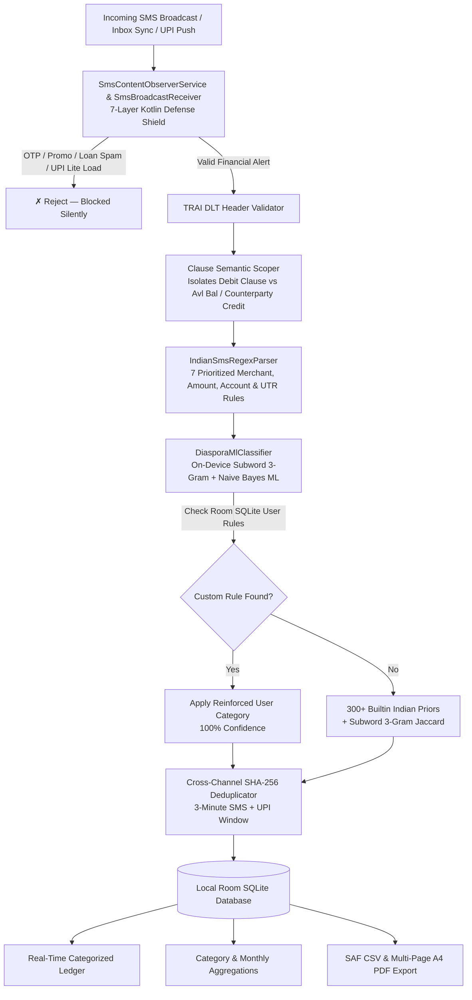

# FinTracker

**Privacy-first, on-device ML-powered expense tracking for Indian financial SMS & UPI (UPI • Cards • Banks)**

[](https://kotlinlang.org)
[](../../releases)
[](LICENSE)
[](https://developer.android.com)
[](#on-device-subword-ml-engine)
[](#privacy--architecture)
[](#testing)

FinTracker is an Android application designed to parse Indian financial SMS messages and UPI push notifications to automatically categorize transactions. It utilizes an on-device Subword N-Gram and Multinomial Naive Bayes model written entirely in Kotlin to extract merchant, amount, and account details with zero cloud dependency and strict data privacy.

---

## Table of Contents

- [Why This Project](#why-this-project)
- [Key Features](#key-features)
- [Privacy & Architecture](#privacy--architecture)
- [System Architecture](#system-architecture)
- [On-Device Subword ML Engine](#on-device-subword-ml-engine)
- [Technology Stack](#technology-stack)
- [Getting Started](#getting-started)
- [Build & Release](#build--release)
- [Testing](#testing)
- [Contributing](#contributing)
- [License](#license)

---

## Why This Project

Traditional expense tracking applications often suffer from two major drawbacks: manual entry is tedious, and cloud-based automated tracking compromises user privacy. This project addresses both issues:

- **Automated Tracking:** Transactions are captured automatically from financial SMS messages (UPI, credit/debit cards, IMPS/NEFT, bank alerts) and UPI app push notifications.
- **Strict Data Privacy:** All parsing and ML inference operations occur on-device. `android.permission.INTERNET` is absent from `AndroidManifest.xml`—there is no backend, no analytics SDK, and no remote API.
- **Localized for India:** The system is explicitly trained and tested against Indian banking formats (HDFC, SBI, ICICI, Axis, Kotak, PNB, Bank of Baroda) and NPCI UPI handles (`@okaxis`, `@ybl`, `@oksbi`, `@okhdfcbank`, `@okicici`, `@ibl`, `@paytm`).

---

## Key Features

### Intelligent Classification
- **On-device Subword N-Gram & Naive Bayes classifier** (pure Kotlin): Classifies each extracted transaction across 8 spending categories (`Food`, `Groceries`, `Transport`, `Bills`, `Shopping`, `Transfers`, `Health`, `Entertainment`) in under **0.25 ms** per message.
- **Compact Footprint:** Under **45 KB** in-memory vocabulary (`DiasporaVocabulary.kt`) backed by quantized subword n-gram priors (`scripts/train_quantize_indian_sms_model.py`).
- Automated filtering of pre-approved loan advertisements, phishing attempts, UPI Lite wallet top-up loads, and OTP verification codes.

### Native 7-Layer SMS & UPI Defense Shield
- Background Kotlin capture services (`SmsContentObserverService.kt`, `SmsBroadcastReceiver.kt`, and `PaymentNotificationListenerService.kt`) that intercept incoming bank SMS and UPI app alerts natively on-device.
- Verified TRAI DLT commercial sender-header checks (`AD-HDFCBK`, `VM-ICICIB`, `JD-SBIUPI`) restrict processing to genuine financial alerts.
- Cross-channel SHA-256 deduplication (`Amount | NormalizedMerchant | 3-Minute Window`) prevents double-counting when both a bank SMS and a UPI push notification arrive for the same payment.

### Deep Transaction Parsing
- **Multi-tier regex pipeline (`IndianSmsRegexParser.kt`):** Incorporates **Clause Semantic Scoping** to isolate extraction to the relevant debit clause, preventing confusion between counterparty credits (`; ZUDIO RETAIL credited`), available account balances (`Avl Bal`), credit limits (`Avl Limit`), and transaction amounts.
- **Indian Numbering & Bare-Amount Support:** Parses Indian comma grouping (`1,24,500.00`), standard currency prefixes (`₹`, `Rs.`, `INR`), and bare PSU bank amounts (`debited by 640.50`).
- **Extensive Compatibility:** Supports 7 prioritized extraction rules covering HDFC, ICICI, SBI, Axis, Kotak, IDFC First, PNB, BOB, Google Pay, PhonePe, Paytm, BHIM, and CRED.

### Adaptive Learning
- **Custom merchant rules (`ml_token_weights`):** Users can reassign any merchant to a category (e.g., `"Kaveri Tiffin Centre"` to `"Food & Dining"`). The application immediately reinforces those merchant tokens in SQLite and applies them to future and historical entries.

### Data Export & Reporting
- Zero-permission local document export via Android's Storage Access Framework (`ExportManager.kt`), generating RFC-4180 CSV spreadsheets and multi-page A4 PDF financial reports.
- Complete 22-page academic documentation included in [`docs/FinTracker_Project_Report.pdf`](docs/FinTracker_Project_Report.pdf).

---

## Privacy & Architecture

> **User financial data is strictly confined to the local device.**

| Property                   | Guarantee                                      |
| -------------------------- | ---------------------------------------------- |
| Internet permission        | None (`android.permission.INTERNET` omitted)   |
| Cloud servers              | None                                           |
| Remote APIs                | None                                           |
| Native C++/Python binaries | None                                           |
| Third-party analytics      | None                                           |
| Storage                    | Local Room SQLite (`AppDatabase`) only         |
| ML inference               | On-device pure Kotlin, `< 0.25 ms` per SMS     |

The entire data pipeline—receipt, filtering, clause scoping, regex extraction, classification, deduplication, and storage—executes securely and locally on the user's device.

---

## System Architecture



---

## On-Device Subword ML Engine

A pure-Kotlin subword n-gram and Multinomial Naive Bayes implementation (`DiasporaMlClassifier.kt` + `DiasporaVocabulary.kt`) eliminating the need for Python, C++, or TensorFlow Lite runtime dependencies during inference and online training.

| Specification      | Details                                                                                          |
| ------------------ | ------------------------------------------------------------------------------------------------ |
| Target Categories  | `FOOD`, `GROCERIES`, `TRANSPORT`, `BILLS`, `SHOPPING`, `TRANSFERS`, `HEALTH`, `ENTERTAINMENT`    |
| Feature extraction | VPA suffix stripping (`@okaxis`, `@ybl`), compound bigrams, 3-char subword n-gram Jaccard        |
| Online learning    | Persistent token weight reinforcement in SQLite (`ml_token_weights` table)                       |
| Vocabulary size    | **< 45 KB** (300+ Indian & diaspora merchant priors + uint8 quantization script)                 |
| Inference latency  | **< 0.25 ms** per message                                                                        |

**Why Subword N-Grams?** Character trigrams and VPA handle normalization render the classifier highly robust against bank-truncated merchant strings (e.g., `SWIGGYIN`, `BLINKITGROC`), concatenated UPI handles (`patelbrothers@okaxis`), and regional merchant names.

---

## Technology Stack

| Layer         | Technology                                                                                      |
| ------------- | ----------------------------------------------------------------------------------------------- |
| Platform      | Native Android (`minSdk 24`, `targetSdk 36`)                                                    |
| Language      | Kotlin `2.2.10` (Coroutines & `StateFlow`)                                                      |
| Database      | AndroidX Room SQLite `2.7.0` (`transactions`, `monthly_budgets`, `ml_token_weights`)            |
| Preferences   | Jetpack DataStore Preferences `1.1.7`                                                           |
| SMS & UPI     | `ContentObserver` (`content://sms`), `SMS_RECEIVED` BroadcastReceiver, `NotificationListenerService` |
| ML Engine     | Custom pure-Kotlin Subword 3-Gram Jaccard + Multinomial Naive Bayes (`DiasporaMlClassifier.kt`) |
| Document I/O  | Native `android.graphics.pdf.PdfDocument` + RFC-4180 CSV via Storage Access Framework           |

---

## Getting Started

### Prerequisites

- **Android Studio** (Ladybug / Meerkat or newer) with **JDK 17**
- **Android SDK** (API Level 24 or higher)
- An Android device or emulator running **Android 7.0 (API 24)** or higher

### Setup

```bash
# 1. Clone the repository
git clone https://github.com/spiyushprakash/FinTracker.git
cd FinTracker

# 2. Assemble the debug (Tester) APK
./gradlew :app:assembleDebug

# 3. Assemble the production (User) APK
./gradlew :app:assembleUser
```

> **Note:** Upon initial launch on a device, grant SMS permission to allow the application to synchronize financial messages. In Android Studio, use **View → Tool Windows → Build Variants** to switch between `debug` (**Tester Build**) and `user` (**User Build**).

---

## Build & Release

```bash
./gradlew :app:assembleUser :app:assembleDebug
```

Pre-compiled APKs and the Project Report PDF are available directly in **[GitHub Releases](../../releases)**:

| Target                        | Output / Release Asset                                                                 |
| ----------------------------- | -------------------------------------------------------------------------------------- |
| **User Build APK** (`user`)   | [`FinTracker-user.apk`](../../releases) (`ENABLE_TESTING_TOOLS = false` — production)  |
| **Tester Build APK** (`debug`)| [`FinTracker-tester-debug.apk`](../../releases) (`ENABLE_TESTING_TOOLS = true` — QA)   |
| **Project Report (PDF)**      | [`FinTracker_Project_Report.pdf`](docs/FinTracker_Project_Report.pdf)                  |

- **`FinTracker-user.apk`**: Clean end-user binary with all synthetic SMS simulation triggers and parser lab tools removed at compile time.
- **`FinTracker-tester-debug.apk`**: Evaluator/QA binary retaining the `+1 / +3 / +5 Bank SMS` batch simulator and the interactive **Indian Regex SMS Parser Lab**.

---

## Testing

Execute the automated JVM and Robolectric test suite using the following command:

```bash
./gradlew :app:testDebugUnitTest
```

Expected output:

```text
BUILD SUCCESSFUL
12 tests completed, 0 failed
```

Test coverage (`SmsParserAndMlTest.kt` and `ExampleRobolectricTest.kt`) includes: Indian regex extraction (`Debited`, `Spent`, `Paid`), Clause Semantic Scoping on compound semicolon alerts, TRAI header validation, OTP and promotional loan spam blocking, online ML token reinforcement, Indian `3-then-2` numbering formatters, and Robolectric batch SMS ingestion.

---

## Contributing

Contributions are welcome. For significant architectural changes or new bank regex rules, please open an issue first for discussion.

1. Fork the repository
2. Create a feature branch (`git checkout -b feat/your-feature`)
3. Commit your changes (`git commit -m 'feat: add bank regex rule'`)
4. Push to the branch (`git push origin feat/your-feature`)
5. Open a Pull Request (ensure `./gradlew :app:testDebugUnitTest` executes without errors)

---

## License

Distributed under the **MIT License**. See [`LICENSE`](LICENSE) for complete details.

---

<p align="center">
  Developed for secure, private financial tracking.<br>
  Please consider starring this repository if you find it beneficial.
</p>
